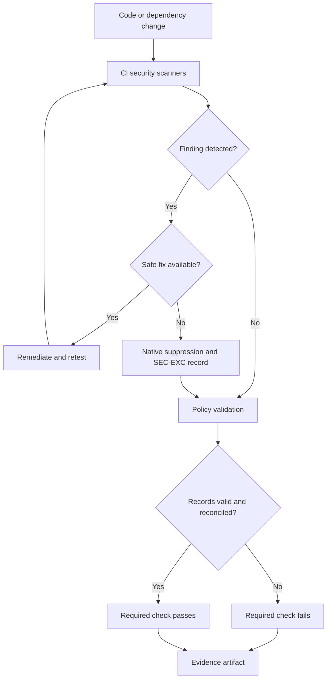

# Phase 11 DevSecOps Architecture

## Purpose

The Phase 11 architecture connects existing scanners to a shared governance
model. Detection tools remain responsible for identifying technical findings;
the policy layer determines whether a finding blocks delivery, requires
remediation, or has a documented temporary exception.

## Control Flow

## Components

| Layer | Components | Responsibility |
| --- | --- | --- |
| Detection | Gitleaks, CodeQL, Trivy, Checkov, Dependabot | Identify secrets, code weaknesses, vulnerabilities, and configuration risk. |
| Native enforcement | Workflow thresholds, Checkov skip lists, Trivy ignore policy | Make reviewed scanner behavior reproducible. |
| Governance | Security gates and exception registry | Define SLAs, ownership, rationale, compensating controls, status, and expiration. |
| Validation | Policy validator and negative-control tests | Reject malformed, missing, duplicated, expired, or orphaned records. |
| Merge control | Protected `main` ruleset | Require pull requests and the stable governance check before merge. |
| Evidence | GitHub Actions artifact | Retain run metadata, syntax validation, policy output, and negative-test output for 90 days. |

## Trust Boundaries

### Pull-request boundary

Changes reach `main` only through the repository ruleset. Direct deletion and
non-fast-forward updates are blocked, squash is the approved merge method, and
the required governance check evaluates every pull request without path filters.

### Workflow-token boundary

The governance workflow grants only `contents: read`. It does not request an
OIDC token, security-event writes, pull-request writes, or repository writes.
Artifact upload uses the GitHub Actions artifact service without expanding the
workflow token's repository permissions.

### Exception boundary

Scanner-native ignores are not authoritative approvals. Every active ignore
must map to a unique active registry record. Conversely, every active registry
record must map to an enforcement input, preventing inactive paperwork from
misrepresenting actual scanner behavior.

### Public-disclosure boundary

Undisclosed vulnerabilities use GitHub private vulnerability reporting. Public
issues are reserved for findings that are already disclosed or otherwise safe
to track publicly. Templates warn against posting secrets, exploit details,
customer data, or sensitive infrastructure information.

## Evidence Model

Each governance run records:

- generation time in UTC;
- repository, event, ref, and commit SHA;
- workflow, run ID, and attempt;
- Bash syntax validation output;
- direct policy-validation output; and
- positive and fail-closed negative-control results.

The upload step uses `if: always()` so failed controls still produce reviewable
evidence. `if-no-files-found: error` prevents an apparently successful evidence
step from silently retaining nothing.

## Vulnerability Treatment Example

The backend hardening work demonstrates the intended workflow:

1. Trivy identified fixable Spring, Tomcat, and Jackson findings.
2. Source reachability and dependency trees were reviewed.
3. Spring Boot was upgraded to 4.0.8, Spring Framework to 7.0.9, Tomcat to
   11.0.25, and Jackson to 3.1.7.
4. Seven integration tests and a container health smoke test verified behavior.
5. The application JAR rescanned with zero HIGH or CRITICAL findings.
6. Four Debian runtime findings still had no vendor fix and were reassessed
   against the fresh October 18 Distroless image.
7. Their native suppressions remain governed through November 7, 2026.
8. Five earlier runtime suppressions were removed and their governance records
   were closed after the refreshed scanner databases stopped reporting them.

## Commercial Deployment Considerations

A production or customer deployment should add independent exception approval,
environment-specific CODEOWNERS, centralized long-term evidence storage,
organization rulesets, enterprise secret-scanning features, and ticket-system
integration. The portfolio implementation models the technical workflow but
does not claim production segregation of duties.
